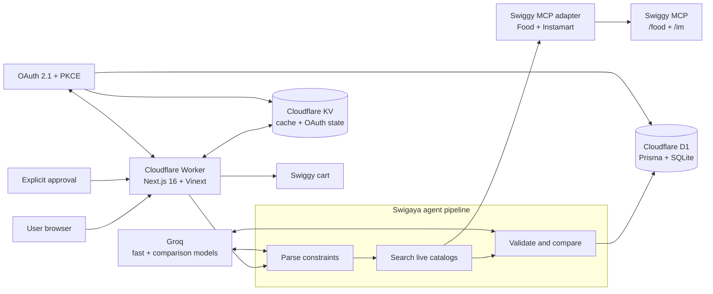
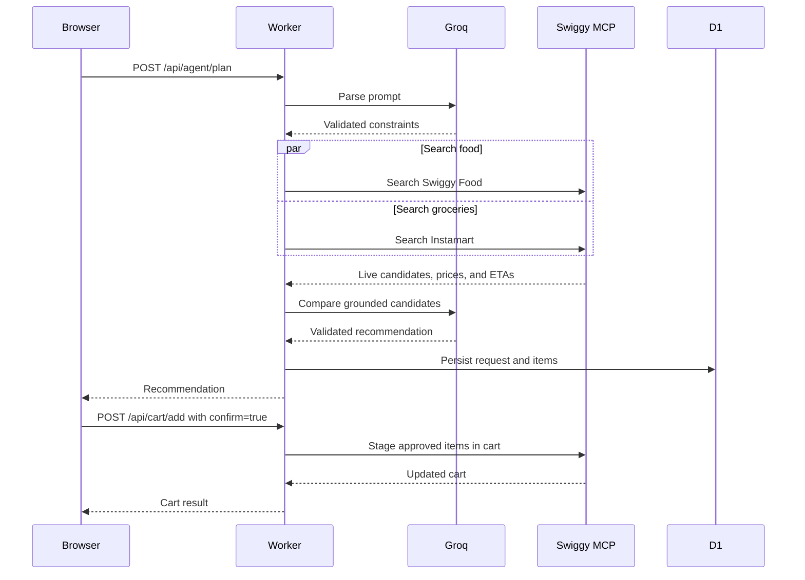
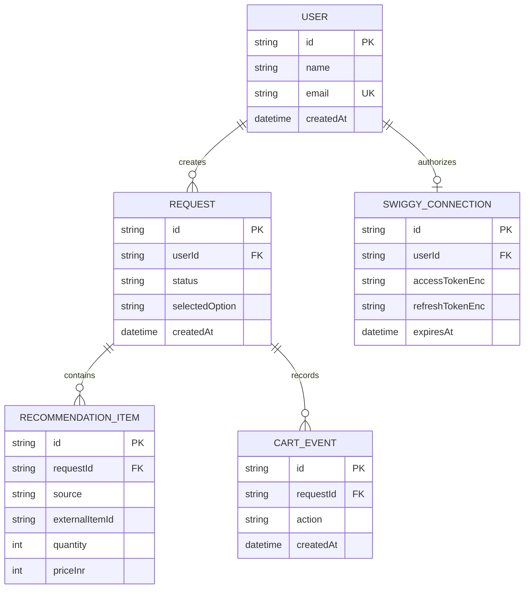

# Swigaya

### Intelligent food-versus-grocery decisions for Swiggy

Swigaya helps users decide between ordering prepared meals through Swiggy Food
and buying ingredients through Swiggy Instamart.

It analyzes budget, dietary preferences, pantry items, serving count, and
maximum acceptable wait time. It then searches live restaurant menus and
grocery catalogs, compares total cost and time-to-table, and presents a
recommendation. Items are added to the Swiggy cart only after explicit user
approval.

> **Important:** Swigaya never pays for or places an order.

## Introductory video

The repository includes a narrated product pitch walkthrough, approximately
1 minute 44 seconds long, at
[`public/swigaya-intro.mp4`](./public/swigaya-intro.mp4). It is kept as a
standalone repository asset and is not embedded in the web UI. The video uses
the supplied Swigaya product screenshots, explains the constraint-driven
planning flow and live Food/Instamart comparison, includes the supplied
architecture diagram, and closes with the explicit cart approval boundary.

### Video details

| Property | Value |
| --- | --- |
| Format | MP4 |
| Duration | Approximately 1 minute 44 seconds |
| Video | H.264, `yuv420p`, 1920 × 1080 |
| Audio | Narrated AAC stereo track |
| Source | Supplied Swigaya product screenshots and architecture diagram |

To watch the video locally after cloning the project:

```bash
open public/swigaya-intro.mp4
```

On Linux, use `xdg-open public/swigaya-intro.mp4`; on Windows, use
`start public/swigaya-intro.mp4`. The generated video is intentionally ignored
by Git, so it must be restored or copied into `public/` locally rather than
uploaded with the source repository.

The repository does not contain a checked-in catalog-image library. Product
images in the application are supplied by the live Swiggy adapter when
available; the walkthrough therefore uses rendered Swigaya UI and architecture
visuals rather than presenting unrelated stock photography as application data.

---

## Contents

- [Core Value Proposition](#core-value-proposition)
- [System Architecture](#system-architecture)
- [Safety and Security Guarantees](#safety-and-security-guarantees)
- [Technology Stack](#technology-stack)
- [Data Models and Database Schema](#data-models-and-database-schema)
- [Setup Guide](#setup-guide)
- [Prerequisites](#prerequisites)
- [Environment Configuration](#environment-configuration)
- [Local Development Setup](#local-development-setup)
- [Cloudflare Deployment](#cloudflare-deployment)
- [API Reference](#api-reference)
  - [Agent Planning](#agent-planning)
  - [Cart Management](#cart-management)
  - [Swiggy OAuth and Status](#swiggy-oauth-and-status)
  - [Analytics and Catalog](#analytics-and-catalog)
- [Testing and Verification](#testing-and-verification)
- [Operational Assumptions and Limitations](#operational-assumptions-and-limitations)
- [Troubleshooting](#troubleshooting)
- [Legal Disclaimer](#legal-disclaimer)

---

## Setup Guide

Choose the setup path that matches your goal:

| Goal | Recommended path |
| --- | --- |
| Run Swigaya locally | Complete [Local Development Setup](#local-development-setup). |
| Deploy a new production environment | Complete [Cloudflare Deployment](#cloudflare-deployment). |
| Validate code without external services | Run [Testing and Verification](#testing-and-verification). |

### First-time local setup

```text
Install Bun and Node.js
        ↓
Install dependencies
        ↓
Create .dev.vars and add GROQ_API_KEY
        ↓
Generate TOKEN_ENC_KEY
        ↓
Apply local D1 migrations
        ↓
Start the development server
        ↓
Connect Swiggy from the Cart page
```

Run the complete local flow:

```bash
bun install
cp .dev.vars.example .dev.vars
openssl rand -base64 32
# Add the generated key to TOKEN_ENC_KEY in .dev.vars.
# Add your Groq key to GROQ_API_KEY in .dev.vars.
bun run db:migrate:local
bun run dev
```

Then open <http://localhost:5173>, go to **Cart**, and connect your Swiggy
account. Planning requires both a configured `GROQ_API_KEY` and a live Swiggy
connection.

### Production setup order

For production, complete these steps in order:

1. Provision the Cloudflare D1 database and KV namespace.
2. Update the placeholder IDs in [`wrangler.jsonc`](./wrangler.jsonc).
3. Set the public HTTPS `SWIGGY_MCP_REDIRECT_URI`.
4. Store `GROQ_API_KEY`, `TOKEN_ENC_KEY`, and any OAuth client secret with
   `wrangler secret put`.
5. Apply remote D1 migrations.
6. Run typecheck, tests, and the production build.
7. Deploy the Worker.
8. Smoke-test OAuth, planning, cart approval, cart updates, removal, and
   disconnect.

See [Cloudflare Deployment](#cloudflare-deployment) for the exact commands.

> **Security note:** Do not commit `.dev.vars`, API keys, OAuth client secrets,
> encryption keys, local databases, or generated build output.

---

## Core Value Proposition

Modern on-demand food delivery apps optimize for spontaneous purchasing rather than cost-time-effort trade-offs. Swigaya acts as a personal food economist:

1. **Natural Language Constraint Parsing**: Extracts budgets (in INR), dietary restrictions (vegetarian, vegan, eggetarian, non-vegetarian), meal types, prep tolerances, and pre-existing pantry inventory from plain text.
2. **Parallel Catalog Evaluation**: Queries Swiggy Food restaurants and Swiggy Instamart grocery selections in parallel.
3. **Pantry-Aware Grocery Planning**: Cross-references curated home recipes against the user's on-hand ingredients (e.g., spices, rice, oil) to avoid purchasing items already in stock.
4. **Multi-Factor Decision Matrix**: Evaluates ready-to-eat vs. cook-at-home options based on total financial cost (including estimated delivery fees and small-cart surcharges), time-to-table (delivery ETA plus active cooking duration), nutritional upside, and surplus portions.
5. **Human-in-the-Loop Cart Preparation**: Generates a verified cart candidate and stages it to the user's active Swiggy session only after explicit, affirmative human consent. Swigaya never initiates payment or final order placement.

---

## System Architecture

Swigaya runs at the edge on Cloudflare Workers using the Vinext runtime
(Next.js 16 App Router). Cloudflare D1 provides relational persistence through
Prisma, while Cloudflare KV stores short-lived cache entries and OAuth state.



### Request lifecycle



### Execution pipeline

1. **Parse input.** `/api/agent/plan` converts the prompt and optional UI
   filters into a strict `Constraints` object. Missing critical values produce a
   structured follow-up question.
2. **Search catalogs.** The authenticated MCP adapter searches Swiggy Food and
   Instamart. Candidate builders apply diet, budget, pantry, serving, and
   delivery-time constraints.
3. **Compare options.** Groq evaluates grounded candidates. Prices, totals,
   and ETAs are calculated from adapter data rather than invented by the model.
4. **Persist the result.** The recommendation and itemized line items are
   written to D1 with status `PLANNED`.
5. **Stage approved items.** `/api/cart/add` reads the persisted items, requires
   explicit approval, stages them in the active Swiggy cart, and records an
   audit event.

---

## Safety and Security Guarantees

Swigaya implements a zero-trust model regarding autonomous purchasing, external API interactions, and user financial security.

| Security Property | Implementation Mechanism |
| --- | --- |
| **No Autonomous Purchases or Payments** | The adapter layer (`lib/swiggy/types.ts`) explicitly omits checkout, wallet, UPI, and card payment APIs. Swigaya's MCP client restricts outgoing tool invocations to an immutable allowlist (`ALLOWED_TOOLS`). The user must open Swiggy directly to pay and place the final order. |
| **Enforced Human-in-the-Loop Approval** | The `/api/cart/add` route strictly mandates `{ confirm: true }`. If missing or false, the operation rejects with HTTP 400 (`NOT_CONFIRMED`). |
| **Tamper-Proof Item Selection** | The client payload to `/api/cart/add` accepts only `requestId` and `confirm`. Line items, quantities, and prices are loaded exclusively from server-side database records generated during planning. Clients cannot inject arbitrary items or manipulate unit pricing. |
| **No Hallucinated Items, Prices, or ETAs** | The LLM never synthesizes catalog IDs or prices. The LLM only selects among real candidate IDs pre-fetched from Swiggy's catalog. Stored prices and ETAs are computed directly from adapter responses. Unknown IDs returned by the model are rejected. |
| **Strict Output Schema Validation and Repair** | All model outputs are bound to Zod schemas using strict JSON Schema validation. In the event of a format deviation, an automatic repair retry is issued to the model before falling back to deterministic heuristics. |
| **Encrypted Token Storage at Rest** | Swiggy OAuth tokens (access and refresh tokens) are encrypted prior to D1 persistence using AES-256-GCM via the Web Crypto API, keyed by `TOKEN_ENC_KEY`. |
| **Controlled Concurrency and Rate Limiting** | The MCP client employs an internal semaphore limiting concurrent requests to two in-flight operations, shielding downstream Swiggy APIs from bursts. Groq HTTP 429 errors are caught and surfaced gracefully. |
| **Zero Silent Mock Fallback** | In production (`SWIGGY_MCP_ENV=live`), planning requires an active, authenticated Swiggy connection. If unauthenticated, the application yields HTTP 409 prompting connection rather than deceptively serving cached sample catalogs. |

---

## Technology Stack

### Runtime and Framework

- **Runtime**: Cloudflare Workers (Edge V8 isolate runtime with `nodejs_compat`)
- **Web Framework**: Next.js 16 (App Router) compiled via `@vinext/cloudflare` and `vite`
- **Language**: TypeScript 5+ (Strict Mode)

### Frontend and UI

- **Component Primitives**: Base UI (`@base-ui/react`) and shadcn/ui (`style: base-nova`)
- **Styling**: Tailwind CSS v4 with `@tailwindcss/postcss`
- **Iconography**: Tabler Icons (`@tabler/icons-react`)
- **Component naming**: Source component files use kebab-case, for example
  `components/cart-view.tsx` and `components/explore-menu.tsx`.
- **Responsive cards**: Catalog cards use fixed responsive image frames, image
  fallbacks, and touch-friendly full-width actions. Cart rows stack safely on
  narrow screens without hover-only interactions.
- **Location-aware options**: The results page omits the Instamart card when no
  grocery plan is available for the user's location, inventory, diet, budget,
  or time constraints.

### Data and Storage

- **Database**: Cloudflare D1 (Serverless SQLite)
- **ORM / Client**: Prisma ORM with `@prisma/adapter-d1`
- **Cache and Ephemeral State**: Cloudflare KV (10-minute cache on catalog queries; PKCE state management)

### AI and LLM Integration

- **SDK**: Groq Official SDK (`groq-sdk`)
- **Reasoning Model**: `openai/gpt-oss-120b` (Deep multi-attribute comparison and scoring)
- **Extraction and Summary Model**: `openai/gpt-oss-20b` (Low-latency constraint parsing and explanation generation)
- **Output Enforcement**: Strict Zod schemas with JSON Schema definition generation

### Integrations and Protocols

- **API Protocol**: Model Context Protocol (MCP) via `@modelcontextprotocol/sdk` (Streamable HTTP Transport)
- **External Services**: Swiggy Food MCP (`https://mcp.swiggy.com/food`) and Swiggy Instamart MCP (`https://mcp.swiggy.com/im`)
- **Authentication**: OAuth 2.1 with PKCE (RFC 7636) and Dynamic Client Registration (RFC 7591)

---

## Data Models and Database Schema

The database is managed through Prisma and deployed to Cloudflare D1:



### Model Definitions

- **User**: Represents an application identity (defaults to `demo-user` in the current release).
- **Request**: Stores the original user prompt, parsed constraints (`parsedConstraintsJson`), generated recommendation payload (`recommendationJson`), decision status (`PLANNED` or `NEEDS_INFO`), and user choice (`food` or `grocery`).
- **RecommendationItem**: Individual line items associated with a planned request, recording `source` (FOOD or GROCERY), `externalItemId`, item `name`, `quantity`, and `priceInr`.
- **CartEvent**: Audit trail tracking actions performed against the cart (`ADD`, `UPDATE`, `REMOVE`, `VIEW`) alongside serialized payload details.
- **SwiggyConnection**: Per-user OAuth connection metadata containing `clientId`, AES-GCM encrypted tokens (`accessTokenEnc`, `refreshTokenEnc`), expiration timestamps, and scopes.

---

## Prerequisites

Before setting up Swigaya, ensure you have:

- **Bun** (version 1.3+ recommended; `packageManager` is set to `bun@1.3.9`)

- **Node.js** (version 20+ required for Cloudflare Wrangler tooling)

- **Cloudflare Account** (with permissions to create Workers, D1 databases, and KV namespaces)

- **Groq Cloud API Key** (from https://console.groq.com)

- **OpenSSL** (for generating the 256-bit token encryption key)

---

## Environment Configuration

The application requires the following environment variables and bindings:

| Variable | Scope | Type | Default Value | Description |
| --- | --- | --- | --- | --- |
| `GROQ_API_KEY` | Secret | string | (Required) | API key for Groq inference. |
| `TOKEN_ENC_KEY` | Secret | string | (Required) | 32-byte base64 string for AES-256-GCM token encryption. |
| `GROQ_MODEL` | Var | string | `openai/gpt-oss-120b` | Model used for constraint comparison and recommendation assembly. |
| `GROQ_FAST_MODEL` | Var | string | `openai/gpt-oss-20b` | Model used for intent extraction and conversational explanations. |
| `SWIGGY_MCP_ENV` | Var | string | `live` | Environment mode (`live` for real Swiggy APIs; `mock` for tests). |
| `SWIGGY_MCP_CLIENT_ID` | Var | string | `""` | Optional static OAuth client ID. Defaults to dynamic client registration. |
| `SWIGGY_MCP_CLIENT_SECRET` | Secret | string | `""` | Optional static OAuth client secret if pre-registered. |
| `SWIGGY_MCP_REDIRECT_URI` | Var | string | `http://localhost:5173/api/swiggy/auth/callback` | OAuth redirect URI. Match your production domain when deployed. |
| `DB` | Binding | D1 Database | - | Cloudflare D1 database binding name. |
| `CACHE` | Binding | KV Namespace | - | Cloudflare KV namespace binding name. |

---

## Local Development Setup

### 1. Clone and Install Dependencies

```bash
git clone <repository-url>
cd swigaya
bun install
```

> **Note:** `bun install` automatically triggers `prisma generate` to generate
> the Cloudflare Workers Prisma client.

### 2. Configure Local Secrets and Variables

Generate a secure 32-byte base64 encryption key:

```bash
openssl rand -base64 32
```

Create `.dev.vars` from the provided template:

```bash
cp .dev.vars.example .dev.vars
```

Edit `.dev.vars` with your settings:

```env
GROQ_API_KEY=gsk_your_groq_api_key_here
GROQ_MODEL=openai/gpt-oss-120b
GROQ_FAST_MODEL=openai/gpt-oss-20b
SWIGGY_MCP_ENV=live
SWIGGY_MCP_CLIENT_ID=
SWIGGY_MCP_CLIENT_SECRET=
SWIGGY_MCP_REDIRECT_URI=http://localhost:5173/api/swiggy/auth/callback
TOKEN_ENC_KEY=your_generated_32_byte_base64_key
```

### 3. Initialize the Local Database

Apply migrations to the local Miniflare D1 database instance:

```bash
bun run db:migrate:local
```

This creates the tables defined in `migrations/0001_init.sql` and seeds the demo user defined in `migrations/0002_seed_demo_user.sql`.

### 4. Start the Development Server

```bash
bun run dev
```

The application will be accessible at `http://localhost:5173`.

---

## Cloudflare Deployment

Deploying Swigaya to Cloudflare Workers requires setting up remote Cloudflare D1 and KV resources, populating production secrets, and executing the build pipeline.

### 1. Authenticate with Cloudflare

```bash
npx wrangler login
```

### 2. Provision Remote Resources

Create the remote D1 database:

```bash
npx wrangler d1 create swigaya-db
```

The command outputs a `database_id` UUID.

Create the remote KV namespace:

```bash
npx wrangler kv namespace create CACHE
```

The command outputs a namespace `id` string.

### 3. Configure `wrangler.jsonc`

Update the `database_id` under `d1_databases` and the `id` under `kv_namespaces` in `wrangler.jsonc`:

```jsonc
"d1_databases": [
  {
    "binding": "DB",
    "database_name": "swigaya-db",
    "database_id": "<YOUR_D1_DATABASE_ID>",
    "migrations_dir": "migrations"
  }
],
"kv_namespaces": [
  {
    "binding": "CACHE",
    "id": "<YOUR_KV_NAMESPACE_ID>"
  }
]
```

Also verify that `SWIGGY_MCP_REDIRECT_URI` under `vars` matches your production domain:

```jsonc
"vars": {
  "SWIGGY_MCP_REDIRECT_URI": "https://swigaya.your-subdomain.workers.dev/api/swiggy/auth/callback"
}
```

### 4. Apply Remote Migrations

```bash
bun run db:migrate:remote
```

### 5. Provision Production Secrets

```bash
npx wrangler secret put GROQ_API_KEY
# Enter your Groq API key when prompted

npx wrangler secret put TOKEN_ENC_KEY
# Enter your 32-byte base64 encryption key when prompted
```

If using a static OAuth client registration with Swiggy:

```bash
npx wrangler secret put SWIGGY_MCP_CLIENT_SECRET
```

### 6. Build and Deploy

```bash
bun run build
bun run deploy
```

To run a dry run build check and verify bundle size before shipping:

```bash
npx wrangler deploy --dry-run --config dist/server/wrangler.json
```

---

## API Reference

### Agent Planning

#### Create Plan / Evaluate Tradeoffs
`POST /api/agent/plan`

Extracts user constraints, queries live Swiggy catalogs, compares food delivery against home cooking, and stores the recommendation.

**Request Headers**: `Content-Type: application/json`

**Request Body**:
```json
{
  "prompt": "I have 300 rupees, vegetarian, 35 mins wait time, and have rice and onion at home. What should I do?",
  "filters": {
    "budget_inr": 300,
    "diet": "vegetarian",
    "max_wait_minutes": 35,
    "people_count": 1,
    "pantry_items": ["rice", "onion"]
  }
}
```

**Response (HTTP 200 - Plan Generated)**:
```json
{
  "status": "ok",
  "requestId": "cm2x...89",
  "constraints": {
    "meal_type": "dinner",
    "budget_inr": 300,
    "diet": "vegetarian",
    "max_wait_minutes": 35,
    "people_count": 1,
    "pantry_items": ["rice", "onion"],
    "health_preference": null,
    "city_or_location_hint": null,
    "missing_information": []
  },
  "result": {
    "recommendation": "grocery",
    "confidence": 88,
    "reasoning": "Cooking saves money and fits comfortably within your 35-minute window.",
    "explanation": "We recommend ordering groceries via Instamart. With your pantry staples, you only need to order dal and tomatoes, yielding 2 meals for under Rs 200.",
    "food_option": {
      "restaurant_id": "rest_123",
      "restaurant_name": "Udupi Delicacy",
      "restaurant_rating": 4.3,
      "items": [
        {
          "item_id": "dish_1",
          "name": "Paneer Thali",
          "quantity": 1,
          "price_inr": 230,
          "line_total_inr": 230
        }
      ],
      "items_subtotal_inr": 230,
      "estimated_fees_inr": 30,
      "estimated_total_inr": 260,
      "estimated_delivery_minutes": 32,
      "diet_compatible": true,
      "fits_budget": true,
      "fits_time": true,
      "pros": ["Zero cooking required", "Hot and fresh"],
      "cons": ["Single portion only", "Near budget cap"]
    },
    "grocery_option": {
      "store_name": "Swiggy Instamart",
      "items": [
        {
          "item_id": "gro_45",
          "name": "Toor Dal 500g",
          "quantity": 1,
          "price_inr": 85,
          "line_total_inr": 85
        },
        {
          "item_id": "gro_12",
          "name": "Tomato 500g",
          "quantity": 1,
          "price_inr": 30,
          "line_total_inr": 30
        }
      ],
      "items_subtotal_inr": 115,
      "estimated_fees_inr": 25,
      "estimated_total_inr": 140,
      "estimated_delivery_minutes": 12,
      "prep_minutes": 20,
      "ready_in_minutes": 32,
      "meals_possible": 2,
      "suggested_recipe": "Dal Tadka with Steamed Rice",
      "pantry_used": ["rice", "onion"],
      "other_recipe_ideas": ["Tomato Rasam"],
      "fits_budget": true,
      "fits_time": true,
      "pros": ["Saves Rs 120", "Provides 2 full meals"],
      "cons": ["Requires 20 mins preparation"]
    },
    "recommended_cart": {
      "source": "grocery",
      "restaurant_id": null,
      "restaurant_name": null,
      "items": [
        {
          "item_id": "gro_45",
          "name": "Toor Dal 500g",
          "quantity": 1,
          "price_inr": 85,
          "line_total_inr": 85
        },
        {
          "item_id": "gro_12",
          "name": "Tomato 500g",
          "quantity": 1,
          "price_inr": 30,
          "line_total_inr": 30
        }
      ],
      "estimated_total_inr": 140
    },
    "warnings": [],
    "data_source": "live"
  },
  "demoData": false,
  "demoReason": null
}
```

**Response (HTTP 200 - Missing Constraints)**:
```json
{
  "status": "needs_info",
  "requestId": "cm2x...90",
  "constraints": { ... },
  "question": "What is your approximate budget for this meal in rupees?"
}
```

**Common Status Codes**:
- `400 BAD_REQUEST`: Missing prompt or invalid schema.
- `409 NOT_CONNECTED`: Swiggy account is not connected.
- `429 RATE_LIMIT`: AI service rate limit reached.
- `502 LLM_ERROR / SWIGGY_UNAVAILABLE`: External service unreachable.
- `503 LLM_NOT_CONFIGURED`: Missing `GROQ_API_KEY`.

---

### Cart Management

#### Add Approved Recommendation to Cart
`POST /api/cart/add`

Stages the items from a previously approved recommendation into the user's active Swiggy cart.

**Request Body**:
```json
{
  "requestId": "cm2x...89",
  "confirm": true
}
```

**Response (HTTP 200)**:
```json
{
  "cart": {
    "success": true,
    "dataSource": "live",
    "restaurantName": null,
    "items": [
      {
        "itemId": "gro_45",
        "name": "Toor Dal 500g",
        "quantity": 1,
        "priceInr": 85
      },
      {
        "itemId": "gro_12",
        "name": "Tomato 500g",
        "quantity": 1,
        "priceInr": 30
      }
    ],
    "totalInr": 140
  }
}
```

#### View Active Cart
`GET /api/cart/get`

Retrieves the current cart contents from Swiggy.

**Response (HTTP 200)**:
```json
{
  "cart": {
    "success": true,
    "items": [ ... ],
    "totalInr": 140,
    "dataSource": "live"
  },
  "demoData": false
}
```

#### Update Cart Item Quantity
`POST /api/cart/update`

Adjusts the quantity of a specific item in the cart (range: 1 to 20). The
server returns the complete updated cart, including all existing food and
Instamart items.

Increasing a quantity preserves every other item. For live Swiggy food carts,
the adapter sends the complete existing restaurant cart with only the selected
line's quantity changed, because the provider may interpret a partial update as
a replacement. Instamart updates similarly merge the full existing grocery
cart before writing it back.

**Request Body**:
```json
{
  "source": "grocery",
  "itemId": "gro_45",
  "quantity": 2
}
```

#### Remove Item from Cart
`POST /api/cart/remove`

Removes an item from the cart (equivalent to setting quantity to 0). The
response contains the complete remaining cart rather than only the removed
item's source.

**Request Body**:
```json
{
  "source": "grocery",
  "itemId": "gro_45"
}
```

#### Add Single Item from Swiggy Search Results
`POST /api/cart/item`

Adds an individual item discovered during catalog exploration to the cart. Requires confirmation.

**Request Body**:
```json
{
  "requestId": "cm2x...89",
  "source": "grocery",
  "itemId": "gro_99",
  "confirm": true
}
```

---

### Swiggy OAuth and Status

#### Check Integration Status
`GET /api/swiggy/status`

Returns whether Swiggy live integration is configured and authenticated.

**Response (HTTP 200)**:
```json
{
  "mode": "live",
  "demoData": false,
  "reason": null,
  "canConnect": true,
  "connected": true
}
```

#### Start OAuth Flow
`GET /api/swiggy/auth/start`

Initiates the OAuth 2.1 authorization code flow with PKCE, redirects to `https://mcp.swiggy.com/auth/authorize`.

#### OAuth Callback Handler
`GET /api/swiggy/auth/callback?code=...&state=...`

Validates PKCE state stored in KV, exchanges authorization code for tokens, encrypts tokens with AES-256-GCM, stores in D1, and redirects back to `/cart?swiggy=connected`.

#### Disconnect Swiggy Integration
`POST /api/swiggy/auth/disconnect`

Purges stored connection tokens from the database.

**Response (HTTP 200)**:
```json
{
  "connected": false
}
```

---

### Analytics and Catalog

#### Retrieve Request History
`GET /api/history`

Returns past recommendations and an aggregated 4-week rolling spending summary.

#### Explore Restaurant or Store Catalog
`GET /api/catalog?requestId=<id>&source=<food|grocery>`

Fetches the complete menu or grocery category list corresponding to the active recommendation.

---

## Testing and Verification

Swigaya includes a comprehensive Vitest test suite covering pipeline logic, LLM retries, cart operations, cryptographic encryption, and rate-limit degradation.

### Running Test Suite

```bash
bun run test
```

Current test suite structure:

- `tests/pipeline.test.ts`: End-to-end plan generation, catalog price verification, constraints enforcement, dietary compatibility checks, and heuristic fallback.
- `tests/cart.test.ts`: Stored item integrity, single-approval enforcement, idempotency, quantity caps, audit logging, and food/grocery quantity increments that preserve other items.
- `tests/llm.test.ts`: JSON schema enforcement, multi-step error repair, Groq client transient error retries, and HTTP 429 status conversion.
- `tests/units.test.ts`: WebCrypto AES-GCM encryption/decryption, PKCE challenge computation, weekly aggregation math, and KV caching layer.

### TypeScript Compilation Check

```bash
bun run typecheck
```

---

## Operational Assumptions and Limitations

1. **User Identity Scope**: The current release operates under a single demo user identity (`demo-user`). Multi-tenant session isolation is ready via the database schema but relies on standard cookie/session management in future revisions.
2. **Delivery Fee Heuristics**: Final delivery surge fees, platform fees, and packaging taxes are determined at checkout by Swiggy's billing engine. Swigaya applies baseline estimates (e.g., Rs 30 for restaurant food orders; Rs 25 for Instamart orders under Rs 199 threshold) for comparison modeling.
3. **Menu Variations and Customizations**: Complex dish variations requiring mandatory modal selections (e.g., custom pizza crusts or beverage size add-ons) are filtered out during candidate selection to avoid staging ambiguous items into the cart.
4. **Cart quantity updates**: Plus actions increase only the selected item's quantity and preserve all other food and Instamart items. Food updates send the complete restaurant cart to avoid provider-side replacement behavior. Live cart responses are re-read after each mutation so the UI reflects the complete cart.
5. **Instamart Cart Behavior**: Instamart's MCP update interface replaces the active cart payload; Swigaya reads the existing cart, merges line items, and commits the unified state.

---

## Troubleshooting

### Error: `LLM_NOT_CONFIGURED` (HTTP 503)
- Cause: The `GROQ_API_KEY` environment variable is either unset or empty.
- Solution: Ensure `GROQ_API_KEY` is present in `.dev.vars` locally or set via `npx wrangler secret put GROQ_API_KEY` in production.

### Error: `NOT_CONNECTED` (HTTP 409 / HTTP 401)
- Cause: Live Swiggy mode is active (`SWIGGY_MCP_ENV=live`) but no valid OAuth token exists in the database.
- Solution: Navigate to the Cart page (`/cart`) and click "Connect Swiggy Account" to complete the authorization flow.

### Error: `RATE_LIMIT` (HTTP 429)
- Cause: Groq inference tier usage limits encountered.
- Solution: Swigaya returns a user-friendly message advising retry in 60 seconds. Consider configuring higher tier Groq credentials or switching `GROQ_MODEL` in `.dev.vars`.

### Database Errors during Local Development
- Cause: Local D1 database state is out of sync with Prisma schema.
- Solution: Run `bun run db:migrate:local` to reapply all SQL migrations to the local Miniflare instance.

### Cart quantity does not change
- Cause: The external cart provider may reject an update or return a partial
  cart response.
- Solution: Confirm that the item belongs to the selected source (`food` or
  `grocery`), then retry. Swigaya now preserves the full cart when increasing,
  decreasing, or removing an item and reports provider failures instead of
  treating them as successful updates.

---

## Legal Disclaimer

Swigaya is an independent project and is not affiliated, associated, authorized,
endorsed by, or in any way officially connected with Bundl Technologies Private
Limited (Swiggy), or any of its subsidiaries or affiliates. The official
Swiggy website can be found at https://www.swiggy.com.

---

## License

No license is currently declared in the repository. Add a `LICENSE` file and
package metadata before distributing this project outside its owning
organization.
